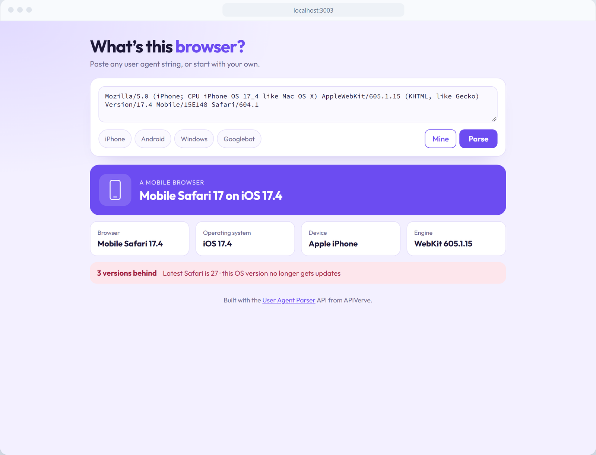

# User Agent Parser | APIVerve Template

[](LICENSE)
[](package.json)
[](tsconfig.json)
[](https://apiverve.com/marketplace/useragentparser?utm_source=github&utm_medium=template&utm_campaign=user-agent-parser-nextjs-tutorial)

A user agent parser you can deploy in one click. It opens on your own browser, then lets you paste any user agent string to see the browser, operating system, device and engine behind it, whether it's a bot, and whether the browser is out of date.

[](https://vercel.com/new/clone?repository-url=https%3A%2F%2Fgithub.com%2Fapiverve%2Fuser-agent-parser-nextjs-tutorial&project-name=user-agent-parser&repository-name=user-agent-parser&env=APIVERVE_API_KEY&envDescription=Your%20APIVerve%20API%20key.%20Free%20to%20create%2C%20no%20card%20needed.&envLink=https%3A%2F%2Fdashboard.apiverve.com%2Fsignup%3Fapi%3Duseragentparser%26utm_source%3Dvercel%26utm_medium%3Dtemplate%26utm_campaign%3Duser-agent-parser-nextjs-tutorial)



---

### Get your free API key

This template needs an APIVerve API key. **[Sign up free](https://dashboard.apiverve.com/signup?api=useragentparser&utm_source=github&utm_medium=template&utm_campaign=user-agent-parser-nextjs-tutorial)**, no credit card required.

---

## Deploy in one click

Click **Deploy with Vercel** above. Vercel copies this repo to your GitHub account, asks for your `APIVERVE_API_KEY`, and gives you a live URL about a minute later.

## Run it locally

```bash
git clone https://github.com/apiverve/user-agent-parser-nextjs-tutorial.git
cd user-agent-parser-nextjs-tutorial
npm install
cp .env.example .env   # then set APIVERVE_API_KEY in .env
npm run dev
```

Open `http://localhost:3000`. To see it in a phone and a browser frame side by side, open `http://localhost:3000/showcase.html`.

## How it works

1. `components/UaApp.tsx` is the page. On load it posts `{ mine: 1 }` to `/api/parse`, which reads the visitor's own `User-Agent` header; pasted strings and the example buttons post `{ ua }`.
2. `app/api/parse/route.ts` checks the input, then calls User Agent Parser. Your API key stays on the server and never reaches the browser. User agents repeat a lot, so answers are cached for a day, and cached answers don't count against the rate limit.
3. The page turns the answer into a headline, four tiles and an up-to-date check, with a drawing for each device type.

Everything on the page works on a free key: browser, OS, device, engine, bot detection and the version check. Paid plans add a one-line summary and suspicious-agent flags; the page uses the summary as its headline when it's there.

```
app/
  api/parse/route.ts   parses a pasted string, or the visitor's own header
  layout.tsx
  page.tsx
  globals.css
components/
  UaApp.tsx            the page
lib/
  apiverve.ts          key, rate limit and cache helpers
public/
  showcase.html        phone and desktop demo frame
```

### The API call

```ts
const res = await fetch('https://api.apiverve.com/v1/useragentparser', {
  method: 'POST',
  headers: { 'x-api-key': process.env.APIVERVE_API_KEY!, 'Content-Type': 'application/json' },
  body: JSON.stringify({ ua: request.headers.get('user-agent') })
});
const { data } = await res.json(); // data.browser, data.os, data.device, data.isBot
```

## Before you share your URL

Once deployed, anyone who finds your URL can use it on your API key. Each visitor can make 10 uncached requests a minute, and repeat lookups come from the cache, which is fine for a demo. Both are kept in memory, so they aren't shared between serverless instances. For production:

- Put the page behind your own sign-in, or
- Move the limit and cache to a shared store such as [Upstash Redis](https://upstash.com/), or
- Call the route only from your own backend.

## Ideas to extend it

- Score traffic for automation with [Bot Detector](https://apiverve.com/marketplace/botdetector).
- Add where the visitor is with [IP Lookup](https://apiverve.com/marketplace/iplookup).
- Flag visitors behind a VPN or proxy with [VPN Detector](https://apiverve.com/marketplace/vpndetector).

## API reference

- [User Agent Parser](https://apiverve.com/marketplace/useragentparser?utm_source=github&utm_medium=template&utm_campaign=user-agent-parser-nextjs-tutorial): `POST https://api.apiverve.com/v1/useragentparser`
- [Full documentation](https://docs.apiverve.com?utm_source=github&utm_medium=template&utm_campaign=user-agent-parser-nextjs-tutorial)

## Tech stack

- **Next.js 16** (App Router) and **React 19**, in **TypeScript**
- A **Route Handler** in `app/api/` for the server side, so the key never reaches the browser
- Deploys to Vercel as-is, with no configuration

## License

MIT. See [LICENSE](LICENSE).
